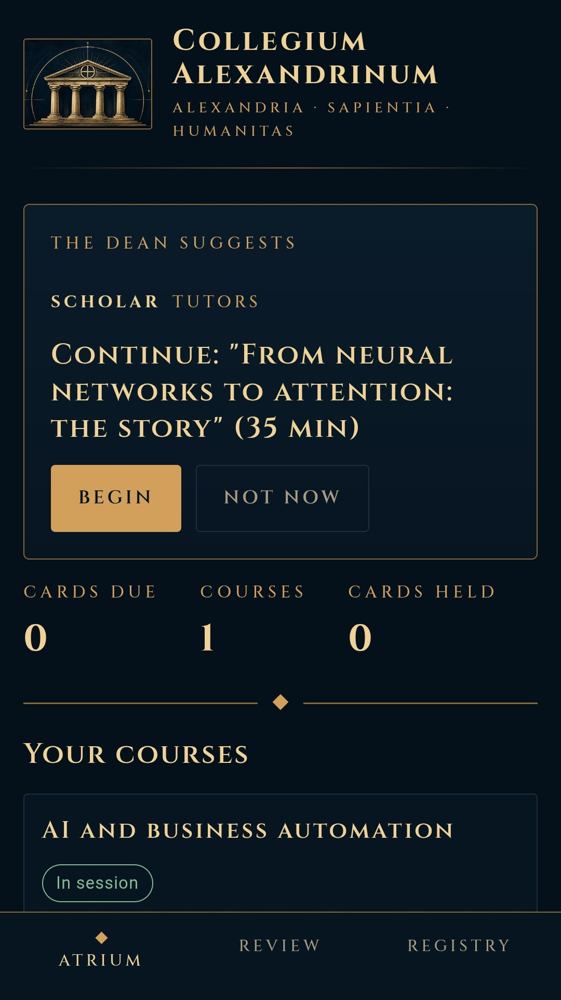
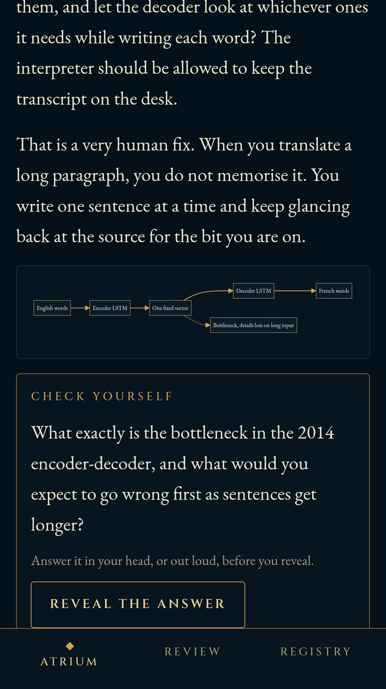
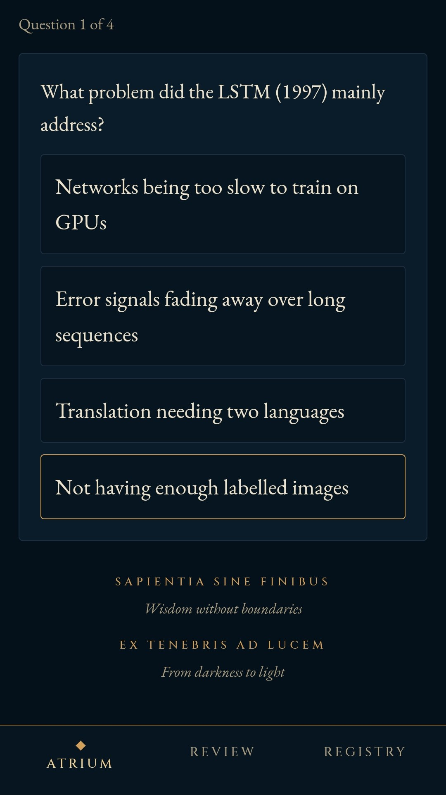

# Collegium Alexandrinum

**A pocket college run by ten AI agents.** Say "I want to learn X". An interviewer agent works out why you want it and what you already know. A team of research and writing agents then builds a full course for you. Tutor, examiner and flash-card agents teach it on your phone.

I designed it from 16 pages of handwritten notes on how people actually learn, then built it with Claude Code. It runs as a private web app on claude.ai, with no server to look after. The first course it built for me, "AI and business automation", has 13 blocks and 46 lessons, about 211,000 words, all researched and fact-checked.

  
  
  

The Atrium, where the Dean picks your next step · A lesson, with a diagram and a check-yourself question · A Proctor quiz

## Why I built it

Most AI tutoring is one chatbot doing everything. The research on learning says that's the wrong shape:

- **Reading feels like learning, but testing is what works.** People who read something once and were tested three times remembered 61% after a week. People who re-read it four times remembered 40%.
- **Spaced review beats cramming.** Reviews at growing gaps keep knowledge from fading.
- **Different moments need different teachers.** Someone starting out needs an interviewer. Someone stuck needs an explainer. Someone who "gets it" needs a questioner who won't hand over the answer.

So each of those jobs is its own agent, with its own spec and a strict output format. A router (the Dean) decides which one you need next.

## How it works

```mermaid
flowchart LR
    A[Student: 'I want to learn X'] --> B[Assessor<br/>interview + 3-level check]
    B --> C[Cartographer<br/>curriculum skeleton]
    C --> D[Scouts x N<br/>web research, cheap model]
    D --> E[Writers, waves of 4<br/>full lessons, stronger model]
    E --> F[validate.py<br/>shape check]
    F --> G[factcheck.py<br/>flags facts not in research]
    G --> H[Checker agent<br/>verifies flagged lines]
    H --> I[Course live on phone]
    I --> J[Scholar tutors<br/>Proctor examines<br/>Registrar schedules reviews]
```

1. **Assess (phone).** The Assessor interviews you: the real reason you're learning, what you know, a three-level knowledge check, and how deep to go (crash course, standard or deep dive).
2. **Build (desktop, once per course).** The web app can't browse the internet, so curriculum building runs in Claude Code:
   - The **Cartographer** drafts the course skeleton: blocks, lessons, objectives, and why each block comes where it does.
   - **Scouts** (Haiku, the cheap fast model) research each block on the web and save dated, sourced notes.
   - **Writers** (Sonnet) write every lesson from the skeleton and the notes, four at a time. A deep lesson is a 20 to 40 minute read with history, diagrams, check-yourself questions, practice and a quiz.
   - **Quality gates:** `validate.py` checks each lesson's structure. `factcheck.py` pulls out every hard fact (years, prices, percentages, version names) and flags any that aren't in the research. A checker agent then verifies only the flagged lines at the source.
3. **Learn (phone).** Read section by section, tap "Go deeper" or ask the **Scholar**. The **Proctor** marks quizzes that get harder after each right answer and step back after a miss. The **Registrar** turns misses into flash cards and books review reminders in Google Calendar.

## The ten agents

| Agent | Role | Status |
|---|---|---|
| Assessor | Interviewer: true reason, baseline, depth | Live |
| Cartographer | Map maker: curriculum, sends out the scouts | Live |
| Scholar | Explainer: teaches, helps when stuck | Live |
| Proctor | Examiner: quizzes that get harder | Live |
| Registrar | Clerk: notes, flash cards, review schedule | Live |
| Dialectician | Socratic questioner, never gives the answer | Specced |
| Logician | Checks the reasoning in your work | Specced |
| Auditor | Listens to you explain it back | Specced |
| Diagnostician | Finds the root gap behind repeated misses | Specced |
| Challenger | Timed role-play and sparring | Specced |

Each spec is in [`agents/`](agents/). The five specced agents are already in the router's table, switched off, so each can be turned on alone.

## Engineering decisions

- **The right model for each job.** Research goes to the cheapest model, writing to a mid-tier one, and the main session only coordinates. It never reads lessons or research notes in full, which keeps its context small.
- **Free checks before paid ones.** Structure and fact checks are plain Python with no AI calls. The AI checker only sees the lines the script flagged.
- **Cost is measured, not guessed.** `costs.py` reads the Claude Code session logs and totals tokens by role. The first deep build read about 71M tokens across 41 sub-agents ([record](examples/costs-2026-10-25.json)). That number sets the usage cap for any paid version.
- **Specs are the source of truth.** `app/build.py` copies the agent specs into the page at build time. Change an agent's behaviour by editing its markdown, not the app code.
- **Safe rendering.** Lesson markdown goes through DOMPurify before it touches the page.
- **Private by design.** Each user's data sits in their own area of the app's database. No API keys or secrets anywhere.

## Repo layout

| Path | What |
|---|---|
| `agents/` | One spec per agent, with strict output contracts |
| `app/index.src.html` | The app: one HTML file, vanilla JS |
| `app/build.py` | Puts the agent specs and crest into the page |
| `build/validate.py` | Lesson structure checker |
| `build/factcheck.py` | Hard-fact extractor and flagger |
| `build/costs.py` | Token cost by role, from session logs |
| `build/writer-brief.md` | The brief every writer agent gets |
| `claude-code/` | The Claude Code skill and sub-agent definitions (scout, writer, checker) that run a build |
| `docs/buildout-notes.md` | My original design notes, typed up |
| `docs/agent-roster.md` | Every agent, its trigger and version |
| `examples/` | Real output from one build: the course skeleton, block 1's research notes, the fact-check flags, a finished lesson and the cost record |

## Running it

- **The app** runs inside a claude.ai artifact, which supplies the model calls and the database. Run `python app/build.py`, then publish `app/index.html` as an artifact.
- **A build** runs in Claude Code with the skill in `claude-code/skill/` and the agents in `claude-code/agents/` copied into a project's `.claude/` folder. Then run `/collegium build`.
- **The checks** run on their own: `python -I build/validate.py <block_dir> deep` and `python -I build/factcheck.py <block_dir> <scout_notes>`.

## What's next

- Turn on the five second-term agents one at a time.
- Freshness checks: re-send the scouts every week or two for fast-moving subjects.
- A format question in the Assessor (visual, listening, hands-on). It changes the mix of formats, not a fixed "learning style", because the research backs mixing formats.
- Package it as a product: onboarding, pricing, usage caps.

---

Built by Joshua with Claude Code, October 2026. Libraries: marked and DOMPurify (MIT/Apache). Fonts: Cinzel and EB Garamond (OFL).
